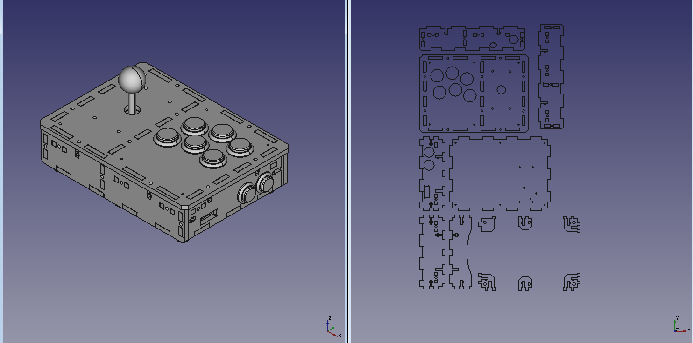
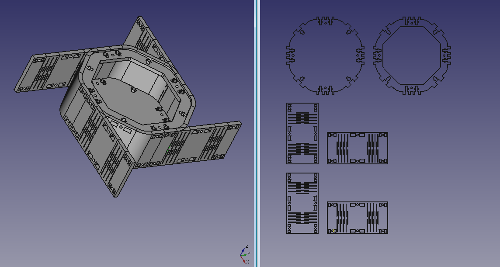
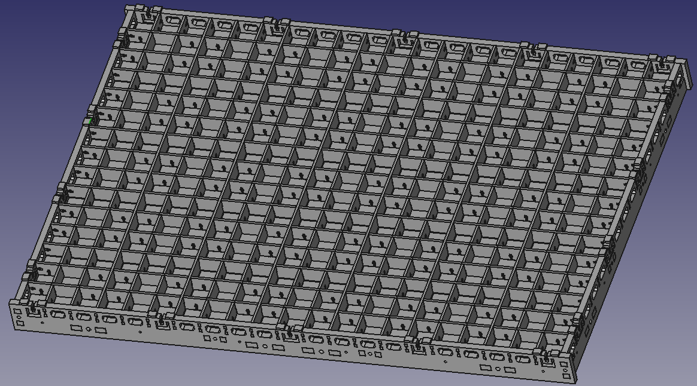

# LCInterlocking - Laser cut interlocking workbench for FreeCAD
Current version 1.5.0 - [release notes](CHANGELOG.md).



## Goal
This experimental FreeCAD workbench is used to create interlocking cut parts from 3D to 2D SVG. 
It was created for laser cutting but can work with CNC router.  

**Important Note:**  
**This is still experimental and as a consequence, not reliable. You must check parts before doing the laser cut.**  
**Please double check the results of this module!**

## Panel
This panel appears when "Laser cut Interlocking" workbench is selected:


## Tools

 *  [Generate box without connection.](docs/box_generator.md)
 *  [Create tabs/slots connection.](docs/interlocking.md) (Interlocking tool)
 *  [Create node for cross connection.](docs/crosspiece.md) (Crosspiece tool)
 *  [Generate rounded box without connection.](docs/rounded_box_generator.md)
 *  [Create bend surface with living hinges.](docs/living_hinges.md)
 *  [Project parts to 2D plan in order to export in SVG format.](docs/export.md) (Export tool)

## Fit and tolerances

The tolerance settings make the slots slightly bigger than the tabs, so parts slide together instead of jamming. Picture a tab on one board pushing through a rectangular slot in another board. The slot has a short side and a long side, and each tolerance widens one of them:

 * **Thickness tolerance** widens the **short side** of the slot, which has to fit the other board's thickness.
   * Plywood sold as 3 mm is often really 3.2 mm, so a slot cut at exactly 3 mm won't fit. A thickness tolerance of 0.2 mm fixes that.
   * The value comes from the board that has the **tab**: it says "this material may be thicker than stated".
   * The default is 10% of the thickness.
 * **Slot width tolerance** lengthens the **long side** of the slot, along the tab's width.
   * A 20 mm tab with 0.1 mm here goes into a 20.1 mm slot, so it doesn't bind at the ends.
   * The value comes from the board that has the **slot**.
   * The default is 0, so tabs fit exactly lengthwise.
 * **Laser beam diameter** works the other way. The laser burns away a thin line, which makes holes come out slightly bigger than drawn, so the slots are shrunk by this amount to compensate.

**Crosspiece:** there are no tabs. Two boards each get a slot and lock together in an X, so each slot only has to fit the other board's thickness. Both tolerances widen that one dimension: thickness tolerance comes from the other board, and slot width tolerance from this board.

**Tuning:** if parts are too tight, raise the matching tolerance. If they are loose or wobbly, lower it, or raise the laser beam diameter. The right values depend on your material and your laser, so cut a small test joint first.

These values, and the other number fields of the Interlocking and Crosspiece tools, can be [bound to variables](docs/expressions.md), for example a Spreadsheet shared by all parts.

## Installation

### Recommended Install
[](https://github.com/FreeCAD/FreeCAD-addons)

Install this Addon via the builtin [FreeCAD Addon Manager](https://github.com/FreeCAD/FreeCAD-addons#1-builtin-addon-manager).  
1. Locate LCInterlocking in the Addon Manager
2. Install
3. Restart FreeCAD  
**Result**: 'Laser cut Interlocking' will be available via the workbench dropdown menu.

### Manual Install
<details>
<summary><i>Expand this to read more about manual installation of LCInterlocking FreeCAD Addon</i></summary>
  
1. Download the repository as zip via the Github interface or use `git` to clone the repo via the command line using:  
```bash
  git clone https://github.com/execuc/LCInterlocking .
```
2. After the download completes, the module must be moved to the `Mod` subfolder of the Freecad install directory.  
 - On Linux: `/home/<username>/.local/share/FreeCAD/Mod`
 - On Windows: `C:\Users\<username>\Appdata\Roaming\FreeCAD\Mod\`
 - On macOS: `/Users/<username>/Library/Application Support/FreeCAD/Mod/`

3. Restart Freecad and the LCInterlocking module should be detected.
</details>

## Troubleshooting Tip
It is advisable to show the FreeCAD report view and to redirect the python errors to show module warning/error.

## Feedback
If you encounter a bug please participate in the [dedicated FreeCAD discussion thread](https://forum.freecadweb.org/viewtopic.php?f=8&t=41196) and open a ticket in this repo's issue queue.

## Some videos previous versions
 * Box generator/interlocking/inkscape: https://youtu.be/YGFIdLpdWXE
 * Box tool: https://www.youtube.com/watch?v=wuu_lRsXGd0
 * Rounded box tool:  https://www.youtube.com/watch?v=lEOgZ6k9Vxw
 * Crosspiece: https://www.youtube.com/watch?v=tIchogx5BLE
 * Rounded corner: https://www.youtube.com/watch?v=KSnMxqjA_-Q
 
## Gallery
  


## License
LGPL v2.1
